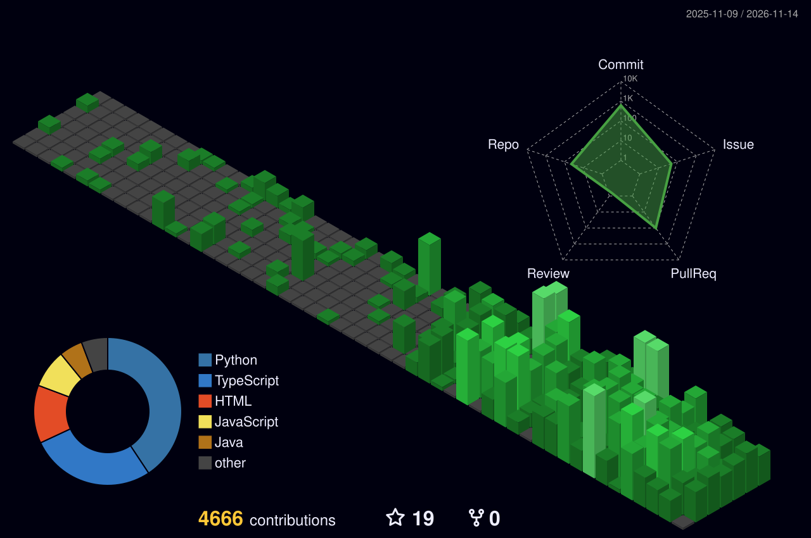

# Ankith M

### AI Engineer · Full-Stack & Mobile Developer · Product Builder

I enjoy taking ideas from **zero to a working, deployed product**. Most of my work sits where AI, software engineering and product meet: multilingual AI in production, agents that ask a person before they act, and benchmarks that show exactly where models fail.

[Portfolio](https://ankith-portfolio.netlify.app) · [DEV](https://dev.to/ankithm1006) · [X](https://x.com/ankithbuilds) · [LinkedIn](https://www.linkedin.com/in/ankith-m-589821257/) · [ankithm113@gmail.com](mailto:ankithm113@gmail.com)

> Understand the problem → design the system → build it → ship it → learn from what happens → improve it.

---

## What I'm building

### VerbX One · [one.verbxeco.com](https://one.verbxeco.com)
Co-founder & Founding Engineer at **[Ivish AI Quantum](https://ivishai.com)** (Dec 2024 – now).

One platform, one account, one wallet: **77 language tools in 76 languages**, from translating text, documents, images, audio and video to app localization, voice agents on the phone, WhatsApp, meetings and a developer API.

- Built backend services in **Python/FastAPI** and **ONNX** inference pipelines for speech-to-text, text-to-speech, OCR, NER, emotion detection and translation
- Real-time cross-language communication over **WebSockets and Redis Pub/Sub**
- **12 packages on npm** for the localization SDK · [npm/verbx](https://www.npmjs.com/org/verbx)
- Mobile: [VerbX Institutional app on Google Play](https://play.google.com/store/apps/details?id=com.verbx.institutionalapp) · [all VerbX apps](https://play.google.com/store/apps/dev?id=5770361439352507458)

### Gatekeeper · [github.com/Ankith-m1006/gatekeeper](https://github.com/Ankith-m1006/gatekeeper)
Four AI agents that live in your team chat and check what coding agents install, **before** they install it. Built on [Switch](https://github.com/sandbox-quantum/switch) for Flip the Switch (WeMakeDevs).

- Catches packages that don't exist (invented by the model), lookalike names, poisoned MCP servers, hidden instructions in `CLAUDE.md`-style rules files, `curl | sh` installers and API keys pasted into chat
- On held-out real malware: flags **84%** on PyPI and **60.5%** on npm, wrongly flags **1 in 500** popular npm packages
- No AI model makes the call, and a person approves anything risky, one exact version at a time
- **[Try it live on Discord](https://discord.gg/qUmdhaY5aD)** · [4-minute demo](https://youtu.be/WKLkfut7NA0) · [build story](https://dev.to/ankithm1006/my-coding-agent-asked-another-agent-for-permission-it-said-no-3m3k)

### Prayana · [prayana.app](https://prayana.app)
An AI-powered travel platform for discovering the many worlds of Karnataka, built **solo, end to end**.

- React Native app with **79 screens**, AI trip planning and personalized day-by-day itineraries
- Offline mode, Firebase, payments and an admin workflow
- A complete consumer product, not just an itinerary generator

### Vigyl
A developer agent that lives on your server: it notices a failed build, proposes the fix, and **writes nothing until a person approves the diff**, from the web or from Claude over MCP. Currently building.

- First public piece: **[Vigyl Hub](https://vigyl-hub-nrxoa2kjeq-el.a.run.app/servers)** · CLI on npm as `@vigylx/cli`

---

## Open source

**69 merged pull requests into [Kestra](https://github.com/kestra-io/kestra)** during Hacktoberfest 2026: **30 fixes and features** in the core engine and plugins (HubSpot, Twilio, Airtable, PagerDuty, AWS, compression and more) and **39 workflow blueprints**. Most fixes start from a bug I found and reported myself, verified at the root cause and shipped with a regression test. [See every merged PR →](https://github.com/pulls?q=is%3Apr+author%3AAnkith-m1006+org%3Akestra-io+is%3Amerged)

---

## Research & evaluation

- **[Ghost Packages](https://github.com/Ankith-m1006/ghost-packages)** · 150 coding prompts to Gemma 4, every install checked live on PyPI and npm. One invented package name came back in 3 of 4 re-asks, predictable enough for an attacker to register. Ships `ghostcheck`, a guard for ghost dependencies.
- **[Indian business data benchmark](https://www.kaggle.com/benchmarks/ankith111111111/indian-business-data-gst-upi-and-lakh-crore)** · 11 models tested on GST rules, UPI references and lakh/crore numbers on Kaggle. Several famous models got Puducherry's GST details wrong.
- **[DawaiGraph](https://github.com/Ankith-m1006/dawaigraph)** · 160K drug-interaction pairs and 70K Indian medicine brands in a graph. An LLM alone found 40% of known interactions on real regimens; graph-backed answers stayed faithful to the source.

---

## Hackathon builds, 2026

Gatekeeper (Flip the Switch) · Vigyl Hub (Builder.io Agent-Native) · [PlateProof](https://github.com/Ankith-m1006/plateproof) (Meta) · DawaiGraph (Graph Hacks) · ShipLog (Wispr Flow, built by voice for 15 days) · Amma's Hour (Amazon Alexa+) · Backlog (Codex × TwitchCon) · [Wolfpack](https://github.com/Ankith-m1006/wolfpack) · Shortlisted, 1 of 6 teams, at the Steer Club hackathon

---

## Writing

Every build gets a write-up on [DEV](https://dev.to/ankithm1006). Recent ones:

- [My coding agent asked another agent for permission. It said no.](https://dev.to/ankithm1006/my-coding-agent-asked-another-agent-for-permission-it-said-no-3m3k)
- [I went ghost hunting inside Gemma 4. It invented a package, and asked for it again.](https://dev.to/ankithm1006/i-went-ghost-hunting-inside-gemma-4-it-invented-a-package-and-asked-for-it-again-5e2p)
- [A failed UPI payment owes you ₹100 a day. I built the sloth that waits to collect it.](https://dev.to/ankithm1006/a-failed-upi-payment-owes-you-100-a-day-i-built-the-sloth-that-waits-to-collect-it-2bdg)
- [Three doctors, eight pills, one graph](https://dev.to/ankithm1006/three-doctors-eight-pills-one-graph-what-my-agent-found-that-nobody-was-looking-for-5h9e)
- [I tested 11 AI models on Indian GST, UPI and lakh-crore](https://dev.to/ankithm1006/i-tested-11-ai-models-on-indian-gst-upi-and-lakh-crore-three-famous-ones-got-puducherry-wrong-53e9)

---

## Experience

**Co-founder / Founding Engineer · Ivish AI Quantum Pvt Ltd** · Dec 2024 – now  
AI and product ecosystem, mainly VerbX: inference, translation, STT, TTS, OCR, NER, backend APIs, mobile apps and cloud.

**Associate Software Developer Intern · [CampX EdTech](https://campx.in)** · Jan – Jun 2026 · Remote  
Production features, reusable UI components, real-time functionality and API integrations across the Student, Faculty and Parent workspaces. The [Student app](https://play.google.com/store/apps/details?id=in.campx.student) I worked on is live on Google Play.

**MIRAI-Setu Japan Industry Program · Kyuden International Corporation, Japan** · Oct 2025  
Selected for the India–Japan government exchange program: Japanese engineering practice, quality processes and structured problem-solving.

**B.Tech, Smart Manufacturing · PDPM IIITDM Jabalpur**

---

## Tech stack

**Languages** `TypeScript` `JavaScript` `Python` `C++` `SQL`  
**Frontend & mobile** `React` `Next.js` `React Native` `Expo` `Tailwind CSS` `Zustand` `Remotion`  
**Backend** `FastAPI` `Node.js` `Express` `REST` `WebSockets` `Socket.IO` `Redis`  
**AI / ML** `LLM evaluation` `AI agents` `MCP` `ONNX` `PyTorch` `STT` `TTS` `OCR` `NER` `Machine translation`  
**Data & cloud** `PostgreSQL` `MongoDB` `Firestore` `Docker` `Google Cloud` `AWS` `Firebase` `GitHub Actions`

---

  

> I don't just like building software. I like taking an idea that doesn't exist yet and making it real.
